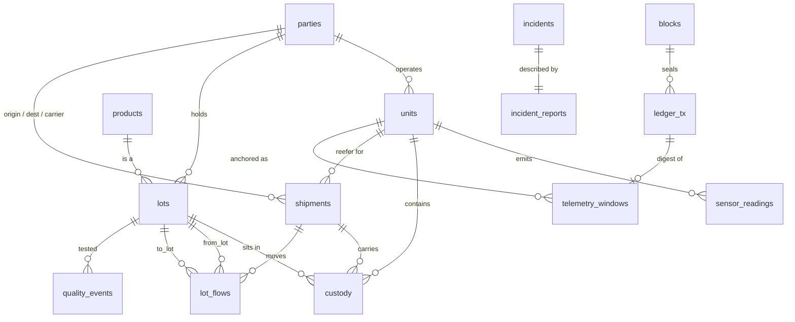

# ChainTwin — relational design

## Entity-relationship diagram



## Tables

| Table | Rows (30 d) | Primary key | Purpose |
|---|---:|---|---|
| `parties` | 18 | `party_id` | Suppliers, the plant, carriers, hubs, stores. Also the ledger's signers |
| `products` | 5 | `product_id` | SKU, storage window (`temp_min`/`temp_max`), shelf life |
| `units` | 29 | `unit_id` | Anything with a thermometer: reefer, cold room, pasteuriser line, display case |
| `lots` | ~1,400 | `lot_id` | **The graph node.** RAW → BATCH → FINISHED → STOCK |
| `lot_flows` | ~1,440 | `(from_lot, to_lot)` | **The graph edge**, with `quantity` |
| `shipments` | ~410 | `shipment_id` | One truck trip |
| `custody` | ~2,400 | `custody_id` | Lot × unit × interval — the join between lots and sensors |
| `sensor_readings` | ~680,000 | — | Time series, range-partitioned by day |
| `quality_events` | ~120 | `event_id` | Lab results |
| `incidents` / `incident_reports` | 420 | `incident_id` / `report_id` | Incident memory, 1:1, with `vector(384)` |
| `blocks`, `ledger_tx` | ~30 / ~2,800 | `height` / `tx_id` | The blockchain |
| `telemetry_windows` | ~830 | `window_id` | Which sensor windows are anchored, and by which tx |
| `audit_logs` | — | `log_id` | Trigger-written trail of lot changes |
| `report_bench`, `demo_injection` | — | — | Benchmark and demo scaffolding only |

## Key design decisions

**Lots are nodes, units are sensors, `custody` joins them.** A thermometer is bolted to a
truck, not to a yoghurt. Modelling the interval a lot spent in a unit is what turns "unit
X was warm from 17:04" into a list of lots with one indexed join.

**The graph is an edge table, not a parent pointer.** A batch has several raw parents and a
raw lot has several batch children, so a `parent_id` column cannot express it. `lot_flows`
supports traversal either way: the primary key serves forward, `idx_flows_to` serves backward.

**Quantities on edges give exposure shares.** `lot_flow_share` is a *view*
(`quantity / sum(quantity) OVER (PARTITION BY to_lot)`), not a stored column, so it cannot
drift from `lot_flows`. Multiplying shares down the recursion gives the fraction of a
downstream lot that traces to a bad ancestor.

**Lots are immutable except `status`.** Everything else is covered by a signed ledger
record; `status` has its own `STATUS_CHANGE` transactions and an audit trigger.

**The ledger stores canonical text.** `ledger_tx.payload` is the exact string that was
hashed, not `jsonb`, because `jsonb` reorders keys and normalises numbers and would make the
stored text differ from what was signed.

## Normalisation

All tables are in third normal form: every non-key attribute depends on the key, the whole
key, and nothing but the key. Deliberate exceptions, each documented in the schema:

* `ledger_tx.payload` repeats business data. That is the point of a ledger — it is a signed
  *copy* to be compared against, not a second source of truth.
* `lots.party_id` is the holder/producer at creation; a lot's later whereabouts are in
  `custody`, so the column is not updated as stock moves.

## Constraints

| Kind | Examples |
|---|---|
| `CHECK` | `quantity > 0`; `lot_type`, `status`, `party_type`, `unit_type`, `flow_type` enumerations; `temp_min < temp_max`; `arrive_time > depart_time`; `to_time >= from_time`; `from_lot <> to_lot` |
| `UNIQUE` | `lots.lot_code`, `parties.name`, `units.name`, `shipments.shipment_code`, `blocks.block_hash`, `ledger_tx.tx_hash`, `incident_reports.incident_id` |
| `FOREIGN KEY` | every reference above; `ON DELETE CASCADE` where the child has no meaning alone (flows, custody, readings, reports) |
| Trigger | `trg_lot_audit` writes `audit_logs` on lot insert/delete and status change; `trg_blocks_immutable` / `trg_tx_immutable` reject `UPDATE`/`DELETE` on the ledger |

`verify.py` attempts nine constraint violations and asserts every one is rejected.

## Indexes, and the query each one serves

| Index | Serves |
|---|---|
| `idx_readings_unit_time (unit_id, time DESC)` on `sensor_readings` | Every sensor query: one unit over a window |
| day partitions | Pruning: a one-hour question touches one or two days of 45 |
| `readings_hourly` (materialised view) + unique `(bucket, unit_id)` | The anomaly baseline; allows `REFRESH … CONCURRENTLY` |
| `idx_custody_unit_time (unit_id, from_time, to_time)` | The exposure join |
| `lot_flows` PK `(from_lot, to_lot)`, `idx_flows_to (to_lot)` | Forward / backward traversal |
| `idx_reports_hnsw` (HNSW, cosine) | Similar-incident search |
| `idx_tx_subject`, `idx_tx_type` | Ledger lookups per lot |

## The recursive CTE

```sql
WITH RECURSIVE hit AS (
  SELECT lot_id, 0 AS depth, 1.0 AS share, ARRAY[lot_id] AS path
  FROM lots WHERE lot_id = ANY(:seeds)
  UNION ALL
  SELECT f.to_lot, h.depth + 1, h.share * f.share, h.path || f.to_lot
  FROM hit h JOIN lot_flow_share f ON f.from_lot = h.lot_id
  WHERE h.depth < 8 AND NOT f.to_lot = ANY(h.path))      -- cycle guard
SELECT … sum(share) … GROUP BY lot
```

The `path` array and depth limit guarantee termination even if bad data introduces a cycle;
`verify.py` inserts one inside a rolled-back transaction to prove it. A lot reached by two
routes has its shares summed (capped at 1).
