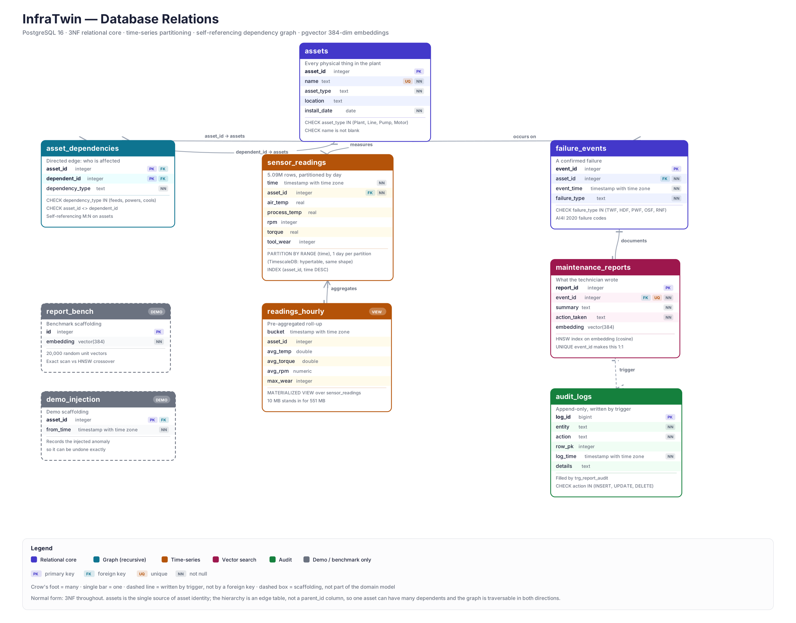

# InfraTwin — DBMS Relations

Reference for the schema. Everything here was read back from a live PostgreSQL 16
database, not written from memory.



---

## 1. Entities at a glance

| Relation | Rows (demo) | Kind | Purpose |
|---|---:|---|---|
| `assets` | 101 | table | Every physical thing in the plant |
| `asset_dependencies` | 100 | table | Directed edges: what is affected by what |
| `sensor_readings` | 5,090,501 | partitioned table | The telemetry stream |
| `readings_hourly` | ~84,000 | materialized view | Hourly roll-up of the above |
| `failure_events` | 336 | table | Confirmed failures |
| `maintenance_reports` | 336 | table | Technician write-up + 384-dim embedding |
| `audit_logs` | 336+ | table | Append-only trail, written by trigger |
| `report_bench` | 20,000 | table | Benchmark scaffolding only |
| `demo_injection` | 3 | table | Demo scaffolding only |

The last two are **not part of the domain model**. They exist so the benchmark
has enough vectors to be meaningful and so the demo anomaly can be undone
cleanly. In a real deployment both are dropped.

---

## 2. Relationships

| From | To | Cardinality | Enforced by |
|---|---|---|---|
| `asset_dependencies.asset_id` | `assets.asset_id` | N : 1 | FK, `ON DELETE CASCADE` |
| `asset_dependencies.dependent_id` | `assets.asset_id` | N : 1 | FK, `ON DELETE CASCADE` |
| `sensor_readings.asset_id` | `assets.asset_id` | N : 1 | FK, `ON DELETE CASCADE` |
| `failure_events.asset_id` | `assets.asset_id` | N : 1 | FK, `ON DELETE CASCADE` |
| `maintenance_reports.event_id` | `failure_events.event_id` | **1 : 1** | FK + `UNIQUE` |
| `readings_hourly` | `sensor_readings` | derived | materialized view |
| `audit_logs` | `maintenance_reports` | N : 1 | **trigger, not a FK** |

Two of these are worth saying out loud:

**`maintenance_reports` is 1:1, not 1:N.** The foreign key alone would permit
many reports per failure. The `UNIQUE` constraint on `event_id` is what makes it
one-to-one. Without it, the vector search could return three rows that are all
the same incident.

**`audit_logs` has no foreign key.** That is deliberate. An audit trail must
survive the deletion of the row it describes; a foreign key with `ON DELETE
CASCADE` would erase the evidence, and `ON DELETE RESTRICT` would make rows
undeletable. The link is by value (`entity`, `row_pk`), written by the trigger.

---

## 3. The dependency graph

`asset_dependencies` is a **self-referencing many-to-many** on `assets`:

```
(asset_id) --dependency_type--> (dependent_id)
```

Read as *"`dependent_id` depends on `asset_id`"* — if `asset_id` fails,
`dependent_id` is affected. The demo plant is four levels deep:

```
Motor --powers--> Pump --feeds--> Line --feeds--> Plant
 (72)              (24)            (4)            (1)
```

**Why an edge table instead of a `parent_id` column on `assets`?**

| | `parent_id` column | edge table |
|---|---|---|
| One asset, several parents | impossible | natural |
| Typed relationship (`feeds` vs `powers` vs `cools`) | nowhere to put it | a column |
| Traverse downward | easy | easy |
| Traverse upward | needs a self-join per level anyway | same |
| Add a redundant cooling path | schema change | one `INSERT` |

A pump fed by two lines is ordinary in a real plant, and `parent_id` cannot
express it. The edge table costs one join and buys the whole class of real
topologies.

**Traversal** is a recursive CTE (`queries.sql` section B). The `depth < 5` guard
is not decoration: a mis-entered pair such as `(A→B)` and `(B→A)` forms a cycle,
and `UNION ALL` without a bound never terminates. `tests/test_infratwin.py::
test_cascade_terminates_on_a_cycle` inserts exactly that cycle and asserts the
query still returns.

---

## 4. Normalisation

The schema is in **third normal form**.

- **1NF** — every column holds one atomic value. No comma-separated dependency
  lists, no JSON blob standing in for columns.
- **2NF** — the only composite key is `asset_dependencies (asset_id,
  dependent_id)`, and its single non-key column `dependency_type` depends on the
  whole key. A dependency *type* is a property of the pair, not of either asset.
- **3NF** — no transitive dependencies. `sensor_readings` stores `asset_id`, not
  the asset's name, type or location; those live once in `assets`. Renaming a
  machine is one `UPDATE`, not five million.

**Where it is deliberately denormalised:** `readings_hourly` is a derived,
redundant copy of data already in `sensor_readings`. That is a conscious trade —
see §7.

**The one judgement call.** `asset_type` and `failure_type` are `TEXT` with
`CHECK` constraints rather than lookup tables. Strict 3NF purism prefers a
`asset_types` table with a foreign key. The values here are a closed set of four
and five, fixed by the physical domain and the AI4I dataset respectively; a
lookup table would add a join to every query to buy flexibility nobody needs. A
`CHECK` gives the same integrity guarantee at zero join cost. If the set became
open — user-defined asset types, say — the lookup table would be correct.

---

## 5. Constraints

Every rule lives in the database, not in application code, so it holds no matter
what connects.

| Relation | Constraint | What it prevents |
|---|---|---|
| `assets` | `UNIQUE (name)` | Two machines with the same tag |
| `assets` | `CHECK asset_type IN (Plant, Line, Pump, Motor)` | Typos becoming new asset classes |
| `assets` | `CHECK length(btrim(name)) > 0` | Blank or whitespace-only names |
| `asset_dependencies` | `PRIMARY KEY (asset_id, dependent_id)` | Duplicate edges |
| `asset_dependencies` | `CHECK asset_id <> dependent_id` | A machine depending on itself |
| `asset_dependencies` | `CHECK dependency_type IN (feeds, powers, cools)` | Undefined edge semantics |
| `failure_events` | `CHECK failure_type IN (TWF, HDF, PWF, OSF, RNF)` | Codes outside the AI4I set |
| `maintenance_reports` | `UNIQUE (event_id)` | More than one report per failure |
| `audit_logs` | `CHECK action IN (INSERT, UPDATE, DELETE)` | Malformed audit entries |
| all FKs | `ON DELETE CASCADE` | Orphaned readings and edges |

`verify.py` and the test suite both attempt violations and assert they are
rejected, so these are demonstrated rather than asserted.

---

## 6. Indexes

| Index | On | Type | Why |
|---|---|---|---|
| `assets_pkey` | `assets(asset_id)` | B-tree | identity |
| `assets_name_key` | `assets(name)` | B-tree unique | tag lookup |
| `asset_dependencies_pkey` | `(asset_id, dependent_id)` | B-tree | **forward traversal** — leading column serves the recursive CTE |
| `idx_dep_dependent` | `(dependent_id)` | B-tree | reverse traversal (what does X depend on) |
| `idx_readings_asset_time` | `sensor_readings(asset_id, time DESC)` | B-tree | the workhorse: every dashboard query is one asset over a window |
| `idx_events_asset_time` | `failure_events(asset_id, event_time DESC)` | B-tree | failure history per asset |
| `idx_events_type` | `failure_events(failure_type)` | B-tree | filter by failure mode |
| `idx_reports_hnsw` | `maintenance_reports(embedding)` | **HNSW, cosine** | approximate nearest neighbour |
| `idx_hourly_bucket_asset` | `readings_hourly(bucket, asset_id)` | B-tree unique | also enables `REFRESH CONCURRENTLY` |
| `idx_bench_hnsw` | `report_bench(embedding)` | **HNSW, cosine** | benchmark |

**Column order in `idx_readings_asset_time` is the whole point.** `(asset_id,
time DESC)` lets `WHERE asset_id = 50 AND time > now() - '24 hours'` seek
directly. Reversed to `(time, asset_id)` the same query scans every asset in the
window and filters. The benchmark measures this as 236 ms → 3.2 ms.

**An honest note on HNSW.** At 339 rows, PostgreSQL ignores
`idx_reports_hnsw` and does a sequential scan — correctly, because scanning 339
rows is cheaper than walking a graph index. HNSW earns its keep at volume, which
is why the benchmark uses `report_bench` with 20,000 vectors, where it is
7× faster. The test suite asserts the index is used there and records the
sequential scan on the small table rather than hiding it.

---

## 7. The time-series layer

`sensor_readings` is **range-partitioned by `time`, one partition per day**.

```sql
CREATE TABLE sensor_readings (...) PARTITION BY RANGE (time);
```

Two things follow:

1. **Partition pruning.** A query for a one-hour window reads one partition, not
   all 48. The planner discards the rest before executing.
2. **Cheap retention.** Dropping data older than 90 days is `DROP TABLE
   sensor_readings_p20260824` — instant — instead of a `DELETE` that rewrites
   millions of rows and leaves bloat behind.

On TimescaleDB the same table becomes a hypertable with `chunk_time_interval =>
1 day`. **The column definitions, the index and every downstream query are
identical**; only the partitioning mechanism differs. That is why the project
ships both paths and detects which to use at setup time.

`readings_hourly` pre-computes hourly averages per asset. It is redundant by
construction — that is the trade:

| | cost | benefit |
|---|---|---|
| Storage | +10 MB on top of 551 MB | — |
| Freshness | stale until refreshed | — |
| 30-day aggregate query | — | 1,253 ms → 45 ms |

On TimescaleDB it is a *continuous aggregate*, refreshed incrementally — only
buckets whose rows changed are recomputed. On plain PostgreSQL it is a
materialized view needing a full `REFRESH`. Same name, same columns, same
queries.

---

## 8. The vector layer

`maintenance_reports.embedding` is `vector(384)` — a `pgvector` column holding
the sentence embedding of the report text.

- **Distance operator** `<=>` is cosine distance, in `[0, 2]`. The queries report
  `1 - distance` as similarity because that is the number an operator can read.
- **Index** is HNSW with `vector_cosine_ops`. The operator class must match the
  operator used in `ORDER BY`, or the index is silently ignored.
- **384 dimensions** is not arbitrary: it is the output width of
  `all-MiniLM-L6-v2`. The schema and the model have to agree, and `seed.py`
  raises if a substituted model has a different width rather than writing
  vectors that are valid but meaningless.

**The failure mode worth knowing:** embedding stored reports with one model and
queries with another produces no error at all. Both vectors are valid, the
distances compute, the results are nonsense. `seed.py` and `app.py` therefore
call the *same* `load_embedder()`.

---

## 9. The audit trigger

```sql
CREATE TRIGGER trg_report_audit
AFTER INSERT OR UPDATE OR DELETE ON maintenance_reports
FOR EACH ROW EXECUTE FUNCTION log_report_change();
```

The function branches explicitly on `TG_OP`:

```sql
IF TG_OP = 'DELETE' THEN v_pk := OLD.report_id;
ELSE                     v_pk := NEW.report_id;
END IF;
```

In a `DELETE` trigger `NEW` is unassigned and in an `INSERT` trigger `OLD` is.
A `COALESCE(NEW.report_id, OLD.report_id)` happens to work on PostgreSQL 16 —
this was tested — but it depends on field access against an unassigned record
returning `NULL` rather than raising, which is not a guarantee worth building
on. The explicit branch costs one `IF` and removes the question.

Because it is `AFTER ... FOR EACH ROW`, the trail cannot be bypassed: it fires
for the application, for `psql`, and for a migration script alike.

---

## 10. Transactions

`seed.py` runs with `autocommit=False` and commits at phase boundaries, so an
interrupted load leaves a consistent database rather than a half-built asset
tree. The 5.09M-row insert is a **single** `INSERT ... SELECT` executed
server-side, which is both one transaction and roughly two orders of magnitude
faster than row-by-row inserts from Python.

`scripts/refresh_demo.py` wraps its revert-then-reinject in one transaction, so
the demo anomaly can never be left double-applied.

---

## 11. Query reference

The three showcase queries are in [`sql/queries.sql`](../sql/queries.sql) with
full commentary. Run them with `-f`, not `-c`:

```bash
psql -d infratwin -v asset=60 -f sql/queries.sql
```

`psql` does **not** interpolate `:asset` in a `-c` string — only in files and
interactive input.

| | Layer | Technique |
|---|---|---|
| **A** | time-series | roll-up + per-asset z-score, with a minimum absolute rise |
| **B** | graph | `WITH RECURSIVE` over the edge table, depth-bounded |
| **C** | vector | HNSW nearest neighbour on cosine distance |

Query A applies **two** conditions, not one. A z-score alone is hypersensitive
when a machine's baseline is nearly flat: an asset whose hourly average varies by
0.1 K crosses z > 3 on a 0.3 K drift that no engineer would call a fault. During
testing this produced exactly one false positive at z = 3.0. Requiring a minimum
absolute rise of 1.0 K as well removes that class of alert while keeping the
per-asset adaptiveness that makes a z-score worth using.
